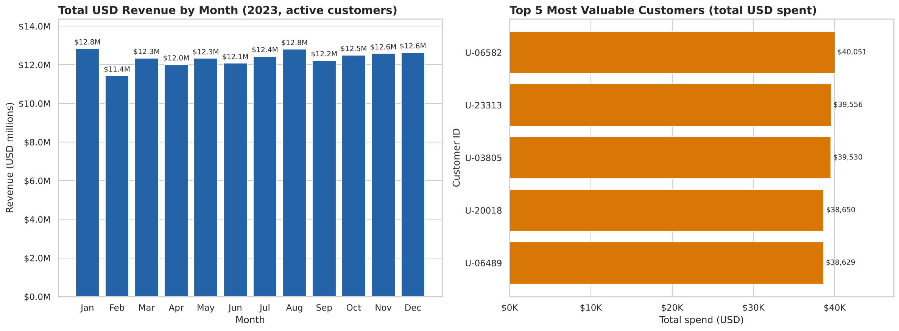
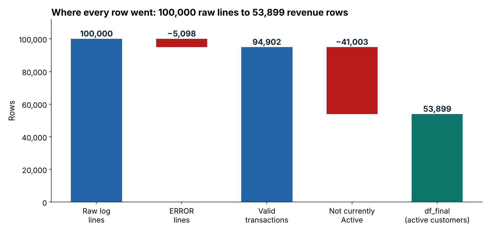

# Enterprise Data Reconciliation

**Reconciling three messy company systems into one trusted USD revenue report for a CFO, using SQL, regex and pandas.**



> Capstone project of the **Data Analytics Internship at iStudio (Internship Studio)**, built by Geetansh Dhapodkar, BCA Semester V, Dr. Ambedkar College, Nagpur.

---

## The problem

A FinTech company sells in **euros**, but its CFO must report to investors in **US dollars**. The data lives in three places, and each one has a trap:

| Source | Trap |
|---|---|
| Accounts database (SQLite) | It is a **history**: one customer has several rows (Pending, then Active, then Suspended). |
| Server log (100,000 text lines) | Purchases are hidden inside text, and **ERROR** lines are failed events, not revenue. |
| Exchange-rate file (CSV) | **104 days have no rate.** |

**The CFO's question:** how much *genuine* USD revenue came from *currently active* customers, by month, and who are the top customers? No transaction may disappear silently.

## The solution in four phases

| Phase | Technique | Output |
|---|---|---|
| 1. Active customers | SQL window function `ROW_NUMBER() OVER (PARTITION BY user_id ORDER BY updated_at DESC)` inside a CTE: rank first, keep `rn = 1`, then filter `Active` | 14,183 active customers |
| 2. Parse the logs | Drop ERROR lines, then one regex with **named groups** and `str.extract` | 94,902 genuine transactions |
| 3. Convert to USD | Sort, **forward-fill** missing rates, **left join** (`validate="many_to_one"`), deliberate **inner join** with active customers, `USD = EUR x rate` | 53,899 rows, $148.3M |
| 4. Report | Aggregate by month and customer, plot with Matplotlib and Seaborn | CFO dashboard |

```python
# Phase 1: latest status per customer, then filter
WITH ranked AS (
    SELECT user_id, name, status, updated_at,
           ROW_NUMBER() OVER (PARTITION BY user_id ORDER BY updated_at DESC) AS rn
    FROM users
)
SELECT user_id, name, status, updated_at
FROM ranked
WHERE rn = 1 AND status = 'Active'
```

## Key results

- **$148.3M** genuine USD revenue (EUR 135.0M) from currently active customers
- Revenue is steady at **$11.4M to $12.8M a month**
- The top 5 customers together are only **0.13%** of revenue, so there is no dependence on one customer
- Converting at daily rates gives **9.9% more** than the raw euro amounts
- Notebook runtime: **about 1.2 seconds**, with no row-by-row loops

### Every row is accounted for



`100,000 log lines - 5,098 ERROR lines - 41,003 non-active customers = 53,899 rows`, checked with `assert` statements in the notebook.

## Design decisions worth noticing

- **Window function, not `WHERE status = 'Active'`.** A plain filter counts customers who were Active once but are Suspended today (17,582 matching rows versus 14,183 truly active customers).
- **Forward-fill the rates.** A plain inner join on the raw rates would silently lose **26,984 transactions (about 28%)**, with no error message. Finance practice is to use the last published rate when the market is closed.
- **I checked the day names.** The brief mentions weekends, but the blank days in this file are Fridays and Saturdays, so the rate carried forward is Thursday's.
- **Left join with `validate="many_to_one"`** keeps every transaction and raises an error if the rates table ever had duplicate dates.
- **Independent cross-check.** The SQL result was rebuilt with pandas (`sort_values` + `groupby().tail(1)`) and the customer sets were identical.

## Tech stack

Python, pandas, SQLite (`sqlite3`), regular expressions (`re`), Matplotlib, Seaborn, Jupyter Notebook.

## Repository structure

```
enterprise-data-reconciliation/
├── notebook/enterprise_reconciliation.ipynb   full solution, with outputs
├── data/                                      the three source files (see data/README.md)
├── images/                                    dashboard and reconciliation charts
├── docs/Enterprise_Reconciliation_Presentation.pdf   24-slide walkthrough
├── requirements.txt
└── README.md
```

## How to run

```bash
git clone https://github.com/<your-username>/enterprise-data-reconciliation.git
cd enterprise-data-reconciliation
pip install -r requirements.txt
jupyter notebook notebook/enterprise_reconciliation.ipynb
```

Run all cells from top to bottom. The notebook reads the files from `data/`.

## Limitations and next steps

- "Currently active" means the **latest status today**, not the status at the time of purchase.
- Possible extensions: a quarterly view, revenue by product, and moving the pipeline into a scheduled script.

## Author

**Geetansh Dhapodkar** · BCA Semester V, Dr. Ambedkar College, Nagpur
LinkedIn: <your LinkedIn profile link>
